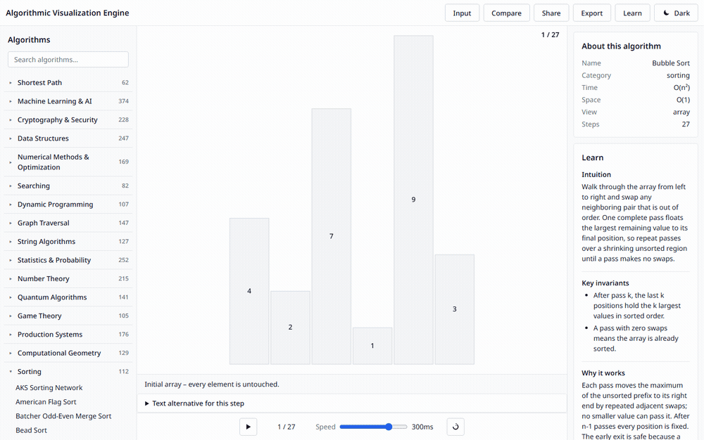
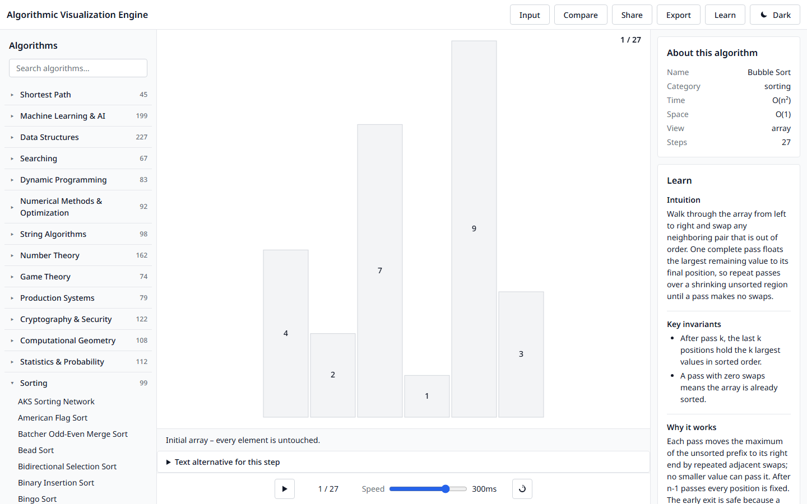
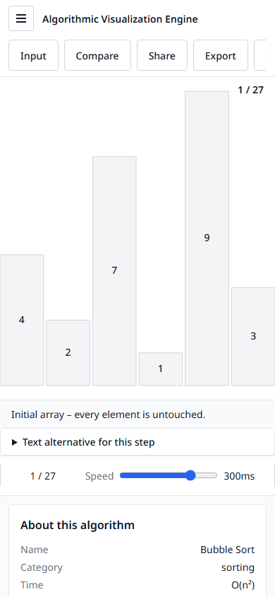

# Algorithm Visualization Engine

An interactive, offline-capable web application that lets you watch 1991 algorithms think, one step at a time.

[](https://github.com/richie-rich90454/algorithm-visualizing/actions/workflows/ci.yml)

[](LICENSE)

[](https://github.com/richie-rich90454/algorithm-visualizing/stargazers)



**[Try the live demo](https://richie-rich90454.github.io/algorithm-visualizing/)** - no sign-up, no build step, runs in your browser. **[Browse the docs](https://richie-rich90454.github.io/algorithm-visualizing/docs/)** for a static, indexable page per algorithm.

## Why this exists

Most algorithm visualizations are either a small curated set of toys or a blank workspace that expects you to write the algorithm yourself. This project takes a different route: a large, growing library of classical and modern algorithms, each already implemented as a deterministic step generator, so you can open any one of them and immediately watch it work.

Everything is self-hosted. There are no third-party CDN dependencies, fonts are bundled locally, and each algorithm is loaded as its own small code chunk only when you open it. The result is a fast, offline-capable teaching tool that stays quick no matter how large the catalog grows.

The library currently contains **1991 algorithm modules** across **20 categories**, backed by **5,793 automated tests**. Every module includes a structured writeup with intuition, invariants, a correctness sketch, complexity rationale, real-world uses, references, and a worked example.

## Features

| Feature | What it means |
| --- | --- |
| Broad, categorized catalog | 1991 modules across 20 categories, from sorting and graphs to quantum algorithms and production systems. |
| Step-by-step replay | Every algorithm is a generator that yields one frame per step. Play, pause, step forward, step back, or reset. |
| Deterministic playback | Frames are precomputed, so revisiting a step is instant and reproducible. |
| Purpose-built layouts | Arrays, grids, matrices, trees, graphs, text, and point clouds each get a renderer matched to their shape. |
| High-DPI canvas | Crisp rendering on retina displays with a single animation loop and dirty-flag redraws. |
| Structured writeups | Intuition, invariants, correctness sketch, complexity rationale, real-world uses, references, and a worked example for every algorithm. |
| Search and browse | Filter the sidebar by algorithm name or id, then open a category tree. |
| Custom input | Edit inputs with friendly forms or advanced JSON, use presets or random data, and re-run instantly. |
| Compare mode | Run two algorithms on the same input with synchronized steps and operation counters. |
| Share and export | Deep links to an algorithm and step, embed snippets, and code export in Python, JavaScript, Java, and C++. |
| Installable and themed | Offline PWA, light/dark themes, reduced-motion support, and keyboard-accessible controls. |
| Keyboard controls | Drive playback without touching the mouse. |
| Offline-capable assets | Local fonts and no CDN dependencies; all assets are served from the app's own origin. |
| Lazy-loaded modules | The initial download is the app shell; algorithm code is fetched on demand. |
| Open and extensible | A plain TypeScript module contract and MIT license make it easy to add your own algorithms. |

## Categories

| Category | Representative algorithms |
| --- | --- |
| Sorting | Bubble Sort, Merge Sort (top-down), Quick Sort (Lomuto) |
| Searching | Binary Search (iterative), Binary Search (recursive), Quickselect |
| Graph Traversal | Breadth-First Search, Depth-First Search (recursive), Topological Sort |
| Shortest Path | A*, Dijkstra (binary heap), Bellman-Ford |
| Minimum Spanning Trees | Kruskal, Boruvka, Prim |
| Network Flow | Dinic, Edmonds-Karp, Hungarian |
| Tree Algorithms | AVL Tree, Tree Hashing, Lowest Common Ancestor |
| String Algorithms | Aho-Corasick, Sunday Quick Shift, Rolling Hash |
| Number Theory | Miller-Rabin, generalized Chinese Remainder Theorem, Baby-Step Giant-Step |
| Dynamic Programming | Edit Distance, Longest Increasing Subsequence, Egg Drop |
| Game Theory | Minimax, Nim, Misere Nim |
| Computational Geometry | Convex Hull (Graham Scan), Convex Hull (Jarvis March), Closest Pair of Points |
| Data Structures | Hash Map (chaining), Segment Tree (iterative), Segment Tree (lazy propagation) |
| Machine Learning & AI | Perceptron, K-Nearest Neighbors |
| Cryptography & Security | One-Time Pad, Caesar Cipher |
| Parallel & Distributed Systems | Parallel Prefix Scan, Bully Leader Election |
| Numerical Methods & Optimization | Secant Method, Jacobi Iteration |
| Quantum Algorithms | Hadamard Gate, Bell State Preparation |
| Statistics & Probability | Bayes' Theorem, Binomial Distribution |
| Production Systems | Token Bucket Rate Limiter, LRU Cache Replacement |

## Screenshots

Desktop:



Mobile:



## Quick start

Requirements: [Bun](https://bun.sh) and a modern browser with Canvas 2D and ES module support.

```sh
bun install
bun dev          # start the dev server
bun run test     # run the unit tests (Vitest)
bun run build    # type-check and produce a production build
```

To regenerate the algorithm manifest after adding or renaming a module:

```sh
bun scripts/gen-manifest.ts
bun scripts/quality-gate.ts
```

See [CONTRIBUTING.md](CONTRIBUTING.md) for the full workflow and quality bar.

## Keyboard shortcuts

| Key | Action |
| --- | --- |
| `Space` | Toggle play/pause |
| `ArrowLeft` | Step backward |
| `ArrowRight` | Step forward |
| `R` | Reset to the first step |

Shortcuts are ignored while the search box or another text input has focus.

## Architecture overview

The engine deliberately keeps algorithms and rendering separate:

- **Algorithm modules** live in `src/core/algo/<category>/<name>.ts`. Each exports an `AlgorithmModule` with metadata, a deterministic input, textbook pseudocode, and a `run` generator that yields `VisualFrame` objects.
- **The manifest** (`src/core/manifest.ts`) is generated. It holds lightweight metadata and one dynamic `import()` per module, so the sidebar and search work instantly while code is fetched only when an algorithm is opened.
- **The store** (`src/stores/visualizer.ts`) is a single Pinia store. A `StepEngine` drains a generator into a frame buffer; playback is pointer movement over that buffer.
- **The frame contract** (`src/types/visual.ts`) declares a `layout` per frame. `VisualContainer.vue` dispatches to the matching layout engine, which positions entities in place, and the canvas renderers paint edges, entities, labels, and overlays.
- **Layout engines** cover arrays, grids, matrices, trees, graphs, text, and point sets, so each algorithm is drawn in its natural shape.
- **Tests** live beside each module and verify that frames are well formed and generation terminates. A generated manifest test checks entry counts and metadata fidelity.

Stack: Vue 3 (Composition API), TypeScript (strict mode), Vite, Pinia, Canvas 2D, Vitest, oxfmt, and Bun.

## How this compares

Honest differences, based on each project's public positioning at the time of writing. Competitor details can change; check each project directly.

| | This project | VisuAlgo | algorithm-visualizer | USP-style applet collections |
| --- | --- | --- | --- | --- |
| Catalog | 1991 modules, 20 categories, growing | Curated set of classic algorithms | User-authored visualizations plus a public gallery | Smaller, topic-specific applet sets |
| Effort to see an algorithm | Click it in the sidebar | Click it in the catalog | Open an existing visualization or write code | Open the relevant applet |
| Write code to visualize | No | No | Usually yes | No |
| Offline-capable | Yes, self-hosted assets and no CDN | Hosted service | Hosted; can be self-hosted | Typically hosted |
| License | MIT | Source available under a research-oriented license | Open source | Varies by collection |
| Primary audience | Students and self-learners first | Students and educators | Developers building visualizations | Students and educators |
| Code line highlighting | Yes, on modules that supply pseudocode | Varies | Depends on the visualization | Varies |

What we do not claim: original algorithm designs, machine-checked formal proofs, or parity with the polish of long-established projects. Every module has a correctness sketch and many have automated brute-force checks; our bet is breadth plus an open, extensible engine.

## FAQ

**Is it free?**
Yes. The project is MIT licensed, with no account, paywall, or tracking.

**Does it really work offline?**
Yes. The app fetches everything from its own origin, bundles its font locally, uses no third-party CDN, and installs as a PWA with a service worker that caches pages for offline reuse.

**Which browsers are supported?**
Any current browser with Canvas 2D and ES module support (recent Chrome, Firefox, Safari, and Edge).

**Do I need to know how to code to use it?**
No. Browse or search the sidebar, open an algorithm, and use the playback controls or keyboard shortcuts.

**How do I add an algorithm?**
Create a module and a test, regenerate the manifest, and run the quality gate. The steps are in [CONTRIBUTING.md](CONTRIBUTING.md).

**Can I use this in a class or a write-up?**
Yes. The MIT license permits reuse. If you publish something that relies on it, a citation is appreciated but not required.

**How are correctness and depth maintained as the catalog grows?**
Each module has a companion test, and the CI quality gate blocks missing pseudocode, descriptions, complexity annotations, TODOs, and spelling regressions. A curated backlog drives new modules, and every module carries the same seven-part writeup.

## Contributing

Contributions are welcome, especially new algorithm modules, correctness fixes, and improved explanations. Read [CONTRIBUTING.md](CONTRIBUTING.md) before opening a pull request, and see [CODE_OF_CONDUCT.md](CODE_OF_CONDUCT.md) for community expectations.

## Citation and references

The algorithms implemented here are classical results credited to their original authors; the contributions of this repository are the visualization engine, the frame-based teaching narrative, and the open catalog. Each module lists its own references in the education section. When using this resource, please also cite the primary textbook or paper for the algorithm itself (for example, Cormen, Leiserson, Rivest, and Stein, *Introduction to Algorithms*).

## License

[MIT](LICENSE) - Copyright (c) 2026 Richard Jiang.
